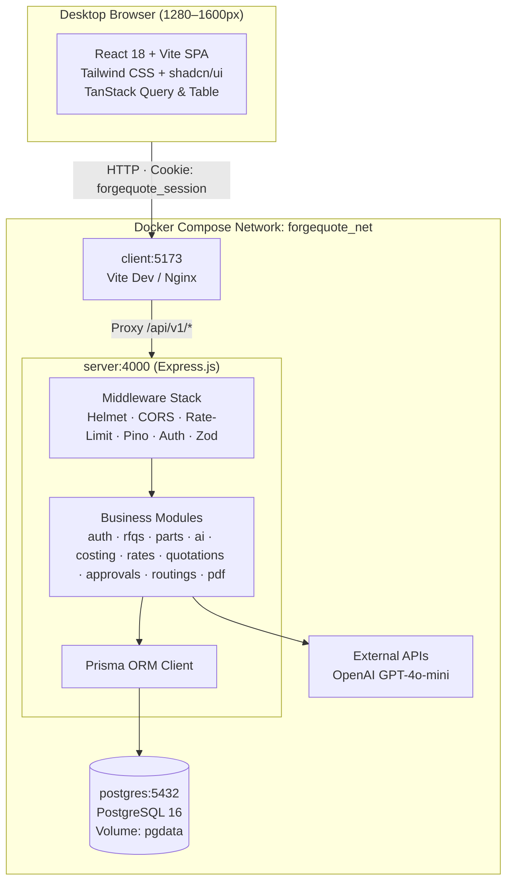

# ForgeQuote ⚡
### AI-Powered RFQ Costing and Quotation Management System

> **Enterprise Manufacturing SaaS** built for precision machining and forging manufacturers.  
> Automates RFQ data intake, deterministic multi-tier costing, historical rate snapshotting, commercial approvals, and PDF quotation generation.

---

## 1. Business Context & Problem Statement

### 1.1 Client Profile
* **Company**: Company A
* **Location**: Chakan, Pune, Maharashtra, India (Automotive & Heavy Forging Corridor)
* **Manufacturing Scope**: Precision CNC/VMC machined and hot-forged components for two-wheeler, tractor, and automotive Tier-1 OEMs.
* **Workforce**: 320 employees | **Annual Turnover**: ₹140 – ₹160 Crore | **Estimation Team**: 6 engineers.

### 1.2 The Quantified Business Problem
| Metric | Historical Reality | Quantified Impact |
|---|---|---|
| Monthly RFQs | 60 RFQs/month (5 parts/RFQ) | 300 parts estimated per month |
| Estimator Time per Part | 2.5 hours manual lookup & calculation | 9,000 engineering hours/year |
| Estimation Labour Cost | ₹450 fully-loaded hourly wage | **₹40,50,000 / year** |
| Delayed Quotation Lost Rate | 5% of RFQs lost due to 9-day response lag | 36 lost RFQs / year |
| Lost Contribution Margin | ₹20 Lakh avg contract @ 12% contribution | **₹86,40,000 / year** |
| **Total Annual Impact** | **Labour Capacity + Lost Contribution** | **₹1,26,90,000 (~₹1.27 Cr/year)** |

### 1.3 How ForgeQuote Solves It
1. **Compresses turnaround** from **9 days to 4 days**.
2. **Reduces estimation effort** from **2.5 hours to ~1 hour per part**.
3. **Structured AI Intake**: Extracts customer, part, weight, and volume details with mandatory human-in-the-loop verification.
4. **Deterministic Financial Costing**: Uses `decimal.js` for arbitrary-precision arithmetic across material, machining, setup, overhead, packing, and freight.
5. **Zero Overwrites**: Historical rate versioning and dual-snapshot quotation records preserve lifelong commercial auditability.
6. **Automated Approval Routing**: Enforces commercial governance for quotations exceeding ₹25,00,000.

---

## 2. Technology Stack

| Layer | Technologies |
|---|---|
| **Frontend** | React 18, Vite, JavaScript (ES Modules), Tailwind CSS, shadcn/ui (Radix UI), TanStack Query v5, TanStack Table v8, React Hook Form, Lucide React, Recharts |
| **Backend** | Node.js (v24), Express.js, JavaScript (ES Modules), Prisma ORM, Zod, Argon2id, Pino Logger, Helmet, express-rate-limit |
| **Financial Engine** | `decimal.js` (Fixed-point mathematical calculations) |
| **Database** | PostgreSQL 16 (UUID keys, Decimal types, JSONB snapshots, relational integrity) |
| **AI Integration** | OpenAI API (`gpt-4o-mini`) encapsulated behind `AIProvider` abstraction (Backend-only key) |
| **Document Engine** | PDFKit (Vector rendering, Indian currency format, separate GST breakdown) |
| **Containerization** | Docker, Docker Compose (Multi-stage non-root production builds, persistent volumes) |

---

## 3. High-Level Architecture



---

## 4. The 8 Desktop-First Screens

1. **Screen 1 — Login**: Secure credential entry, Argon2id verification, HTTP-only session cookie issuance, demo account selector.
2. **Screen 2 — Dashboard / RFQ Register**: Filterable, searchable register with overdue indicators, annual contract values, and owner filtering.
3. **Screen 3 — RFQ Detail & AI Intake**: Split workspace for pasting customer inquiry emails/BOMs, running AI extraction, viewing confidence ratings and source excerpts, and verifying fields.
4. **Screen 4 — Part Costing Workspace**: Core engineering workspace featuring raw material weights, routing operations, cycle times, setup amortisation, and 3 volume tiers (50%, 100%, 150%) calculated side by side.
5. **Screen 5 — Rate Master Management**: Centralized rate registers (Material, Machine Hour, Overhead, Packing, Freight, GST) with version histories and overlap prevention.
6. **Screen 6 — Commercial Approval Inbox**: Sales Head inbox displaying pending quotations exceeding ₹25,00,000 with cost breakdowns and 1-click Approve/Reject actions.
7. **Screen 7 — Quotation Details & PDF**: Immutable quotation view displaying frozen rate snapshots, approval history, simulated customer sending, and direct PDF generation.
8. **Screen 8 — Historical Quotation Search**: Deep multi-criteria search by part name, material grade, customer, and weight range to guide new estimations.

---

## 5. Deterministic Reference Benchmarks

Every calculation in ForgeQuote is grounded in verified engineering benchmarks. All test suites validate against these exact figures:

| Cost Component | Part A: Rear Wheel Spindle (EN8) | Part B: Hydraulic Lift Arm (40Cr4) | Part C: Gear Blank (20MnCr5) |
|---|---|---|---|
| Net Weight / Annual Volume | 0.61 kg / 180,000 units | 4.60 kg / 24,000 units | 1.48 kg / 60,000 units |
| **Material Cost** | **₹54.58** | **₹550.00** | **₹196.81** |
| **Conversion Cost** | **₹45.33** | **₹277.92** | **₹76.00** |
| **Setup Cost** | **₹0.01** | **₹0.24** | **₹0.05** |
| **Overhead Cost** | **₹1.81** | **₹22.25** | **₹4.56** |
| **Packing & Freight** | **₹6.00** (₹4 + ₹2) | **₹18.00** (₹12 + ₹6) | **₹10.00** (₹7 + ₹3) |
| **Total Unit Cost** | **₹107.74** | **₹868.41** | **₹287.42** |
| **Selling Price (Pre-GST, 15% Margin)** | **₹126.75** | **₹1,021.66** | **₹338.14** |
| **GST (18%)** | **₹22.82** | **₹183.90** | **₹60.87** |
| **Final Unit Price** | **₹149.56** | **₹1,205.56** | **₹399.01** |
| **Annual Pre-GST Value** | **₹2,28,15,000** | **₹2,45,19,840** | **₹2,02,88,400** |
| **Approval Rule (> ₹25 Lakh)** | **Requires Approval** | **Requires Approval** | **Requires Approval** |

---

## 6. Quick Start Guide

### 6.1 Using Docker Compose (Recommended)

1. **Clone repository & enter directory**:
   ```bash
   git clone https://github.com/your-org/ForgeQuote.git
   cd ForgeQuote
   ```

2. **Configure environment**:
   ```powershell
   Copy-Item .env.example .env
   # Add your OPENAI_API_KEY to .env if testing live AI extraction
   ```

3. **Start complete stack**:
   ```powershell
   docker compose up --build -d
   ```

4. **Initialize database schema & seed demonstration data**:
   ```powershell
   docker compose exec server npx prisma migrate deploy
   docker compose exec server node prisma/seed.js
   ```

5. **Open in browser**:
   * Application UI: [http://localhost:5173](http://localhost:5173)
   * API Health Check: [http://localhost:4000/api/v1/health](http://localhost:4000/api/v1/health)

---

### 6.2 Pre-Configured Demonstration Accounts

| Role | Email Address | Password | Permissions |
|---|---|---|---|
| **Estimator** | `estimator@forgequote.demo` | `Estimator@123` | Create RFQs, run AI extraction, configure part routings, calculate costs, submit quotations. |
| **Sales Head** | `sales@forgequote.demo` | `Sales@123` | Review approval inbox, approve/reject quotations, manage master rates, simulate customer sending, view audit logs. |

---

## 7. Complete Documentation Index

Detailed architectural and operational documentation is located in the `docs/` folder:

* 📄 **[Technical Design Document (TDD)](docs/TDD.md)**: Deep dive into the client profile, business metrics, software architecture, data models, and testing strategies.
* 📄 **[Deployment & Operations Guide](docs/deployment.md)**: Step-by-step local setup, Docker Compose operations, and cloud deployment on Vercel, Render, and Neon PostgreSQL.
* 📄 **[REST API Specification](docs/API.md)**: Complete OpenAPI-style documentation of all `/api/v1` routes, payload schemas, and status codes.
* 📄 **[Database Architecture & Schema](docs/DATABASE.md)**: Comprehensive ER diagram, Prisma schema design, indexing, and immutable rate snapshotting rules.
* 📄 **[Costing Engine & Financial Rules](docs/COSTING_RULES.md)**: Mathematical formulations, rounding policy, volume tier equations, and reference benchmarks.
* 📄 **[AI Architecture & Structured Intake](docs/AI_DESIGN.md)**: AI extraction prompts, Zod output schemas, confidence scoring, failure fallbacks, and NDA privacy rules.
* 📄 **[Security Architecture & Threat Model](docs/SECURITY.md)**: Argon2id hashing, opaque sessions, CSRF defenses, RBAC enforcement, and anti-self-approval rules.

---

## 8. License & Commercial Rights
Developed for the Company A SDE Assessment. Confidential and proprietary industrial software.
