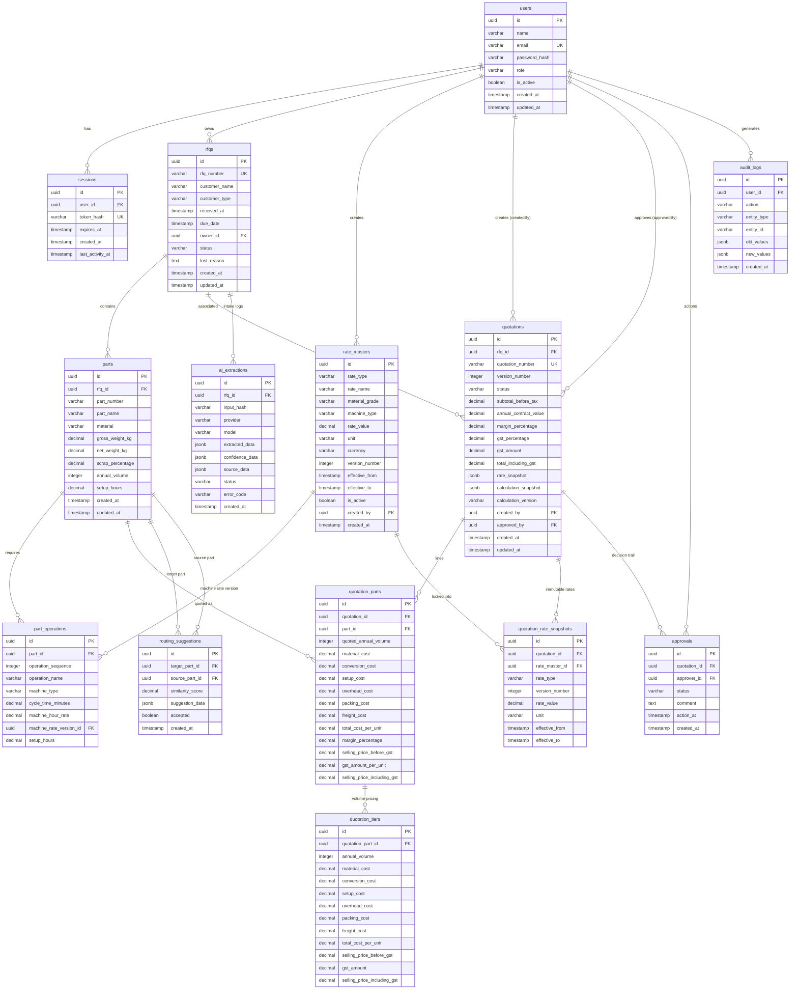

# ForgeQuote — Database Architecture & Schema Specification

**Database Engine**: PostgreSQL 16  
**ORM / Data Access**: Prisma ORM (JavaScript client)  
**Primary Key Strategy**: UUIDv4 (`gen_random_uuid()`)  
**Currency & Money Representation**: Fixed-point `Decimal` / `Numeric`  
**Immutability Strategy**: Relational rate locks + JSONB calculation snapshots

---

## 1. Database Architectural Principles

### 1.1 Why PostgreSQL 16?
1. **Strict Relational Integrity**: Enforces foreign keys, cascade constraints, and unique indexes to prevent orphaned financial records.
2. **Native JSONB Storage**: Allows high-performance immutable snapshot persistence (`rateSnapshot`, `calculationSnapshot`) queryable via JSON path operators (`@>`, `->>`).
3. **Arbitrary-Precision Arithmetic**: Native `NUMERIC` and `DECIMAL` types prevent rounding drift and IEEE 754 binary floating-point representation bugs.
4. **ACID Transactions**: Guarantees that quotation generation, rate locking, tier generation, and audit logging succeed or fail as a single atomic unit.

### 1.2 Fixed-Point Decimal Strategy for Financial Calculations
JavaScript's native `Number` is an IEEE 754 double-precision float. In manufacturing estimation, small floating-point errors (e.g. `0.1 + 0.2 = 0.30000000000000004`) lead to inaccurate multi-tier scrap and amortisation numbers that fail customer audits.

ForgeQuote strictly standardizes on the following PostgreSQL precision tiers:
* **Unit Prices & Rates**: `DECIMAL(12, 4)`
  * Supports values up to ₹99,999,999.9999.
  * Preserves 4 decimal places of sub-rupee precision for high-volume automotive stamping and turning (e.g., ₹0.0125 setup amortisation per unit).
* **Quotation Line Totals & Commercial Contracts**: `DECIMAL(14, 2)`
  * Supports values up to ₹999,999,999,999.99 (₹10,000 Crore).
  * Rounded strictly at display and final invoicing boundaries.
* **Percentages & Margins**: `DECIMAL(5, 2)`
  * Allows `0.00%` to `100.00%` (e.g., 18.00% GST, 15.00% Margin, 5.00% Scrap).
* **Weights**: `DECIMAL(10, 4)`
  * Tracks component weights down to 0.1 gram (0.0001 kg).

---

## 2. Complete Entity-Relationship (ER) Diagram



---

## 3. Indexing Strategy & Performance Optimization

To guarantee sub-100ms response times across an RFQ register of thousands of parts and quotations, the following high-cardinality and filter indexes are configured:

| Table | Index Columns | Index Type | Rationale |
|---|---|---|---|
| `rfqs` | `rfq_number` | B-Tree (UNIQUE) | Fast direct lookup by RFQ identifier |
| `rfqs` | `customer_name` | B-Tree | Filtering & search auto-complete by customer |
| `rfqs` | `status` | B-Tree | Filtering active pipeline (ESTIMATING, SENT, WON) |
| `rfqs` | `due_date` | B-Tree | Sorting and fast overdue detection queries |
| `rfqs` | `owner_id` | B-Tree | Estimator-specific workspace filtering |
| `parts` | `rfq_id` | B-Tree | Cascaded retrieval of parts for an RFQ |
| `parts` | `part_name` | B-Tree | Similarity engine token matching |
| `parts` | `material` | B-Tree | Exact material match for routing suggestions |
| `rate_masters` | `(rate_type, effective_from)` | Composite B-Tree | Accelerated time-travel rate resolution queries |
| `rate_masters` | `(rate_name, rate_type)` | Composite B-Tree | Fast lookup of version histories for a rate item |
| `quotations` | `quotation_number` | B-Tree (UNIQUE) | Direct quotation reference lookup |
| `quotations` | `status` | B-Tree | Approval inbox queue (`PENDING_APPROVAL`) |
| `quotations` | `rfq_id` | B-Tree | Retrieving quote revisions for an RFQ |
| `audit_logs` | `(entity_type, entity_id)` | Composite B-Tree | Retrieving entity-specific audit history |
| `sessions` | `token_hash` | B-Tree (UNIQUE) | Fast O(1) session authentication on every request |
| `ai_extractions` | `(rfq_id, input_hash)` | Composite B-Tree | Deduplication to prevent redundant OpenAI calls |

---

## 4. Rate Versioning & Immutability Architecture

### 4.1 Zero-Overwrite Policy (Append-Only)
In legacy ERP setups, when raw material prices increase (e.g. EN8 price goes from ₹85 to ₹92/kg), operators overwrite the existing table row. Consequently, historical quotations drafted two months earlier silently recalculate with new rates, causing audit discrepancies and customer disputes.

ForgeQuote enforces an **Append-Only Policy**:
1. `RateMaster` rows are never updated with new financial values.
2. A price change results in inserting a new row with `versionNumber = previousVersion + 1`.
3. The previous row's `effectiveTo` timestamp is set to the new version's `effectiveFrom` timestamp.
4. An application-level check prevents overlapping date ranges for the same `rateName` and `rateType`.

### 4.2 Time-Travel Rate Resolution
To determine the authoritative rate at any timestamp $T$:
```sql
SELECT * FROM rate_masters
WHERE rate_type = $1
  AND rate_name = $2
  AND is_active = TRUE
  AND effective_from <= $T
  AND (effective_to IS NULL OR $T < effective_to);
```

### 4.3 Dual-Snapshot Quotation Locking
When a quotation is generated, rates are permanently locked in two complementary ways:
1. **Relational Lock (`QuotationRateSnapshot`)**: Each individual rate used is stored with its version number, rate value, unit, and effective dates.
2. **Document Lock (`calculationSnapshot` JSONB)**: The entire calculation graph (weights, cycle times, setup hours, overheads, packing, freight, margins, and 3 volume tiers) is saved as an immutable JSON document.
3. Even if all master rates are modified in the future, the quotation and its PDF output remain 100% stable and auditable.

---

## 5. Transactional Integrity & Quotation Creation

Quotation creation spans 4 tables and must execute inside a single PostgreSQL ACID transaction:
```javascript
await prisma.$transaction(async (tx) => {
  // 1. Create base Quotation header
  const quote = await tx.quotation.create({ data: quotePayload });

  // 2. Persist QuotationPart lines
  for (const partData of parts) {
    const quotePart = await tx.quotationPart.create({
      data: { ...partData, quotationId: quote.id }
    });

    // 3. Persist 3 volume tiers per part
    await tx.quotationTier.createMany({
      data: partData.tiers.map(t => ({ ...t, quotationPartId: quotePart.id }))
    });
  }

  // 4. Lock applied rates in QuotationRateSnapshot
  await tx.quotationRateSnapshot.createMany({
    data: appliedRates.map(r => ({ ...r, quotationId: quote.id }))
  });

  // 5. Append immutable AuditLog entry
  await tx.auditLog.create({
    data: {
      userId: currentUser.id,
      action: 'CREATE_QUOTATION',
      entityType: 'QUOTATION',
      entityId: quote.id,
      newValues: { quotationNumber: quote.quotationNumber, total: quote.totalIncludingGST }
    }
  });

  return quote;
});
```
If any sub-operation fails (e.g. DB connection dropped during tier insertion), the entire transaction rolls back, preventing incomplete quotation records.
